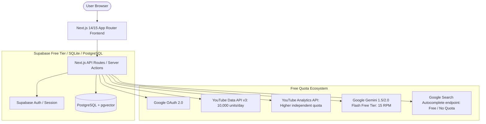

# Blueprint: Building a Free-Tier VidIQ Clone (YouTube Analytics & Growth Engine)

---

## 1. VidIQ Feature Breakdown & How They Work Under the Hood

To recreate VidIQ, we first break down its core feature pillars and the exact data plumbing powering each:

| VidIQ Feature Pillar | Core Capability | Mechanism / Data Source |
| :--- | :--- | :--- |
| **Channel Audit & Analytics** | Real-time views, subscribers, watch time, retention graphs, CTR, traffic sources. | **YouTube Analytics API** (`reports.query`) using User OAuth credentials. |
| **Video Scorecard & SEO** | SEO score (0-100), tag volume/relevance, checklist (cards, end screens, description length, subtitles). | **YouTube Data API v3** (`videos.list` with `snippet,contentDetails,statistics`). |
| **Keyword & Tag Research** | Search volume estimates, competition score, related search tags. | **YouTube Data API v3** (`search.list`) + YouTube autocomplete scraping (free Google Suggest API endpoint). |
| **Competitor Tracking** | Compare your channel metrics vs competitor channels (VPH, views over time). | **YouTube Data API v3** public endpoints (`channels.list`, `activities.list`, `playlistItems.list`). |
| **AI Content Generator** | AI Video Title generator, Description writer, Script outline, Thumbnail idea prompts. | **Free-tier LLMs** (Google Gemini API free tier: 15 RPM / 1M TPM). |
| **Daily Video Ideas** | Predictive topic suggestions with predicted VPH / potential rating. | LLM + Channel Niche embedding comparison using recent top-performing videos. |
| **Best Time to Publish** | Heatmap showing when channel subscribers are most active. | **YouTube Analytics API** hourly day-of-week viewer activity. |

---

## 2. The 100% Free-Tier Architecture & Tech Stack

All services selected have generous permanent free tiers or open-source local execution:



### Free Stack Selection:
1. **Frontend & Backend**: **Next.js (App Router, TypeScript, Tailwind CSS, Lucide Icons, Recharts)**.
2. **Database & Auth Storage**: **Supabase Free Tier** (500MB PostgreSQL, built-in row-level security, encrypting tokens) or local Prisma + SQLite/Postgres.
3. **AI Capabilities**: **Google Gemini 2.0 Flash / 1.5 Flash API** (Free 15 requests per minute, 1 million tokens/day via Google AI Studio).
4. **Hosting**: Local development on your machine (`localhost:3000` / WAMP) and deployable to **Vercel Hobby Tier** (free).
5. **Caching Layer**: In-memory LRU cache / Next.js `unstable_cache` or Supabase table caching to prevent burning YouTube API quota.

---

## 3. YouTube API Quotas & Critical Optimization Techniques

> [!WARNING]
> YouTube Data API v3 gives only **10,000 quota units per day** on the free tier.
> - `search.list` = **100 units** per call (Very expensive!)
> - `videos.list` = **1 unit** per call (Can batch up to 50 videos in 1 request!)
> - `channels.list` = **1 unit** per call
> - `playlistItems.list` = **1 unit** per call (Fetching uploads playlist avoids expensive searches!)
> - **YouTube Analytics API**: Separate quota (quota based on requests per minute, does NOT deduct from the 10,000 Data API units).

### Smart Quota Preservation Hacks:
1. **Fetch Channel Videos via `uploads` Playlist**:
   - Don't use `search.list(channelId)` (100 units).
   - Instead, call `channels.list(part='contentDetails')` once (1 unit), grab the channel's `uploads` playlist ID (`UU...`), then call `playlistItems.list(playlistId)` (1 unit for 50 videos).
2. **Aggressive Database Caching**:
   - Store video metadata and analytics snapshots in PostgreSQL with a 6-to-12-hour TTL (Time-To-Live). Refresh on user demand or background sync.
3. **Keyword Suggestions via Free Autocomplete**:
   - Instead of calling `search.list` for keyword ideas, query `https://suggestqueries.google.com/complete/search?client=youtube&ds=yt&q={keyword}` (Zero quota usage).

---

## 4. Technical Implementation Per Feature

### A. Authentication & Secure Token Flow
* **Scopes Required**:
  - `https://www.googleapis.com/auth/youtube.readonly`
  - `https://www.googleapis.com/auth/yt-analytics.readonly`
* **Flow**:
  1. Frontend redirects user to `/api/auth/google`.
  2. Google OAuth callback returns `code`.
  3. API exchanges `code` for `access_token` and `refresh_token`.
  4. Backend retrieves the user's primary channel ID and details.
  5. Tokens are stored encrypted in the database.
  6. Automatic Token Refresh: Custom wrapper around `google.auth.OAuth2` that listens for token expiry and updates the stored `access_token`.

### B. Channel Dashboard & Video Performance
* Query YouTube Analytics API for:
  - Metrics: `views,estimatedMinutesWatched,averageViewDuration,subscribersGained,subscribersLost`
  - Dimensions: `day` (for line charts) or `video` (for top performers).
* Calculate VPH (Views Per Hour) for recent uploads:
  $$\text{VPH} = \frac{\text{Current Total Views}}{\text{Hours Since Published}}$$

### C. Video SEO Scorecard & Analyzer
* Algorithms checking 10 key SEO parameters:
  1. Title length (ideal 50–70 characters).
  2. Description length (> 200 words recommended).
  3. Tags count & presence of keyword in title and description.
  4. Presence of Cards (`hasCustomThumbnail`, Captions available).
  5. High-resolution thumbnail check (`maxres` thumbnail presence).
* Generates a composite 0-100 score + actionable checklist items.

### D. AI Video Optimization Engine (Free Gemini API)
* **Title Optimizer**: Feeds current video title, top tags, and niche to Gemini 1.5/2.0 Flash to return 5 high-CTR, curiosity-driven titles.
* **Smart Tag Generator**: Extracts semantically relevant tags matching high-ranking search phrases.
* **Thumbnail Concept Generator**: Generates visual composition prompts and color theory advice for thumbnails.

### E. Competitor Channel Tracker
* User inputs competitor channel handles or URLs.
* Backend resolves handle to channel ID using `channels.list(part='snippet,statistics', forHandle=...)`.
* Tracks growth rate and identifies which of their videos are "outlier hits" (VPH > 2x channel average).

---

## 5. PostgreSQL Database Schema

```sql
-- Users & YouTube Connected Accounts
CREATE TABLE channels (
    id UUID PRIMARY KEY DEFAULT gen_random_uuid(),
    user_id UUID NOT NULL,
    yt_channel_id TEXT UNIQUE NOT NULL,
    title TEXT NOT NULL,
    description TEXT,
    custom_url TEXT,
    thumbnail_url TEXT,
    subscriber_count BIGINT DEFAULT 0,
    video_count INT DEFAULT 0,
    view_count BIGINT DEFAULT 0,
    access_token TEXT NOT NULL,
    refresh_token TEXT NOT NULL,
    token_expiry TIMESTAMP WITH TIME ZONE NOT NULL,
    created_at TIMESTAMP WITH TIME ZONE DEFAULT NOW(),
    updated_at TIMESTAMP WITH TIME ZONE DEFAULT NOW()
);

-- Cached Videos
CREATE TABLE videos (
    id UUID PRIMARY KEY DEFAULT gen_random_uuid(),
    channel_id UUID REFERENCES channels(id) ON DELETE CASCADE,
    yt_video_id TEXT UNIQUE NOT NULL,
    title TEXT NOT NULL,
    description TEXT,
    tags TEXT[] DEFAULT '{}',
    published_at TIMESTAMP WITH TIME ZONE NOT NULL,
    thumbnail_url TEXT,
    view_count BIGINT DEFAULT 0,
    like_count INT DEFAULT 0,
    comment_count INT DEFAULT 0,
    duration TEXT,
    seo_score INT DEFAULT 0,
    last_synced_at TIMESTAMP WITH TIME ZONE DEFAULT NOW()
);

-- Competitor Tracking
CREATE TABLE competitors (
    id UUID PRIMARY KEY DEFAULT gen_random_uuid(),
    channel_id UUID REFERENCES channels(id) ON DELETE CASCADE,
    competitor_yt_channel_id TEXT NOT NULL,
    title TEXT NOT NULL,
    subscriber_count BIGINT DEFAULT 0,
    view_count BIGINT DEFAULT 0,
    avatar_url TEXT,
    last_inspected_at TIMESTAMP WITH TIME ZONE DEFAULT NOW()
);
```

---

## 6. End-to-End A-to-Z Execution Roadmap

1. **Step 1: Project Scaffolding & Setup**
   - Initialize Next.js project with Tailwind CSS & Lucide icons.
   - Configure Google Cloud Project (enable YouTube Data API v3 & YouTube Analytics API).
   - Set up Supabase / local DB schema.
2. **Step 2: Authentication Engine & Channel Link**
   - Build Google OAuth redirect & callback routes.
   - Store encrypted access/refresh tokens.
   - Test channel verification and token auto-refresh logic.
3. **Step 3: Analytics & Metric Aggregation**
   - Implement uploads playlist fetcher (low-quota).
   - Integrate YouTube Analytics API endpoint for viewer graphs and retention.
   - Design modern dark-mode analytics dashboard.
4. **Step 4: VidIQ SEO Scorecard & Autocomplete Keyword Engine**
   - Build SEO evaluation algorithm for any selected video.
   - Implement free Google Suggest endpoint integration for live tag suggestions.
5. **Step 5: Free AI Copilot Integration**
   - Integrate Google Gemini API free tier for automated Title/Tag/Description generation.
6. **Step 6: Competitor Spy & VPH Tracking**
   - Add competitor tracking and outlier video discovery.
